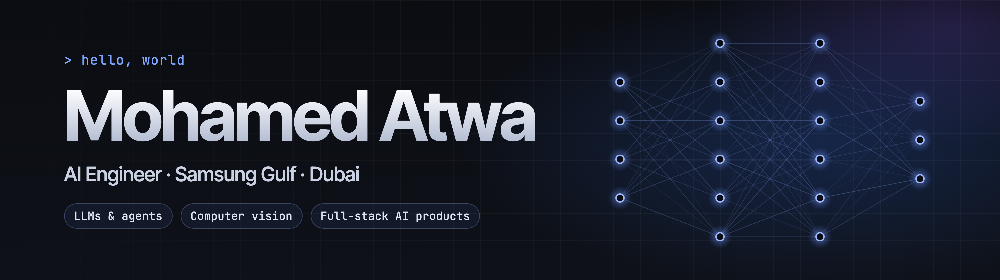

# Hi, I'm Mohamed Atwa

**AI Engineer in Dubai** · Senior AI Associate at **Samsung Gulf**

I build AI products that ship: content-automation platforms, computer-vision creative scoring, sentiment dashboards and analytics tools. I like taking an idea from a notebook to a deployed, tested product that real teams use every day.

---

### What I'm building

| Project | What it does | Stack |
|---|---|---|
| **[MAISTRO](https://github.com/Mohamedatwa7/maistro)** | Content-automation platform for Samsung Gulf social media: trend → content → stage-by-stage approvals → posting → performance tracking. 20 API routes, 237 tests, evals suite. | JavaScript, Vercel serverless, Postgres, Anthropic API |
| **[F1X8](https://github.com/Mohamedatwa7/fixation-ui)** | Creative analyzer that scores images and videos for attention, clarity and engagement, blending computer-vision KPIs with a vision-LLM judgment. | Next.js, Modal GPU, PyTorch, Qwen-VL, Whisper, OpenCV, Claude |
| **[SamsungTrack](https://github.com/Mohamedatwa7/samsungtrack)** | Social sentiment dashboard: brand comments, campaign trackers, influencer roster and review analytics. | Next.js, TypeScript, Supabase |
| **[Athyor](https://github.com/Mohamedatwa7/voice-agent)** | Local voice-agent web UI on Resemble AI's Chatterbox TTS (Turbo on GPU, Nano on CPU). | Python, Next.js |

### Experience

| | Role | When |
|---|---|---|
| **Samsung Gulf** | Senior AI Associate · Dubai | Dec 2025 – present |
| **HUGO BOSS** | AI & Automation · E-commerce Analyst (internship) · Dubai | Apr – Dec 2025 |
| **BCG X** | Corporate master's thesis project: telecom churn and GenAI recommender · Madrid | Jan – Apr 2025 |
| **Pfizer** | Digital Transformation Analyst (internship) · Dubai | Jun – Aug 2023 |

### Education

- **MSc Data Science and Business Analytics** · IE Business School
- **BSc Computer Engineering** · American University of Sharjah

### Tech stack

- **AI / ML:** Claude & OpenAI APIs, LLM evals, PyTorch, Hugging Face Transformers, Qwen-VL, Whisper, OpenCV, scikit-learn, XGBoost, SHAP, spaCy
- **Product:** Next.js, React, TypeScript, Tailwind, Node.js, Express, FastAPI, Streamlit
- **Data & infra:** Supabase / Postgres, Vercel, Modal (GPU), Playwright, GitHub Actions, Cloudflare

---

Open to conversations about applied AI and building AI products in the Gulf.
